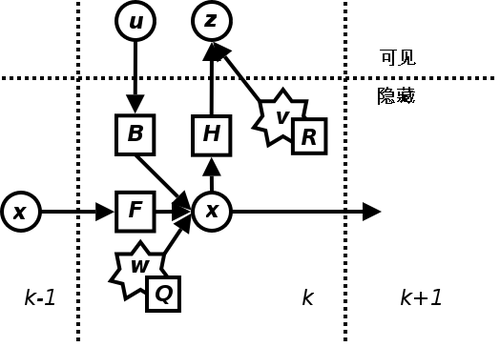

# armor_solver

## 装甲板 V2 TinyMPC

规划器使用双积分模型、10 ms 步长和 100 点参考窗口，yaw、pitch 分轴运行 TinyMPC，并输出窗口中点的绝对角度、角速度和角加速度。仓库启动配置使用加速度可达性选板；新策略要求有效的实际姿态/角速度反馈、匹配的坐标系及有效弹道，否则输出无效参考并撤销开火建议。

参数位于 `solver.mpc` 和 `solver.selection`，修改配置后重启节点。

## 预测可达性选板

`solver.selection.policy: acceleration_reachable` 为每个模型板位分别生成未来瞄准轨迹，结合云台实际角度和角速度评估捕获能力。它不修改 EKF 的马氏距离关联，也不要求相机当前看到该板。

评估从命令时间戳 `now + solver.predict2send_delay` 开始。实际反馈以恒定角速度外推到此时刻；候选板沿用图像年龄、发送延迟、额外预测时间及子弹飞行时间补偿。飞行时间只用于预测命中位置，不作为云台额外可用的转动时间。各板先迭代一次基准命中状态，再按匀速/匀转速模型推进采样；窗口内不逐点重新迭代飞行时间。

捕获评估使用实际云台状态；正常跟踪时按未来攻击窗口调度一次板间接管。三次连接满足出发/到达两端的角度和角速度，检查其最大角加速度，并检查接管后的连续攻击窗口。连接曲线连同当前板和下一板参考一起交给 MPC，电控仍接收 MPC 输出，而非直接接收连接曲线。

| 参数 `solver.selection.*` | 试验默认值 | 含义 |
|---|---:|---|
| `dt` | 0.01 s | 固定评估步长 |
| `horizon` | 0.50 s | 未来评估时域，最大 2 s |
| `capture_deadline` | 0.30 s | 最迟允许对准时刻 |
| `hold_time` | 0.10 s | 最短连续可攻击窗口 |
| `angle_tolerance` | 0.02 rad | 当前两轴各自允许的角度误差 |
| `velocity_tolerance` | 0.10 rad/s | 当前两轴各自允许的角速度误差 |
| `max_facing_angle_deg` | 60° | 命中时板面偏离正面的最大水平夹角，须小于 90° |
| `switch_improvement` | 0.20 | 捕获评分或未出发接管时间的最小改善比例 |
| `switch_hold_time` | 0.05 s | 改善须连续保持的时间 |
| `handoff.max_transfer_time` | 0.30 s | 单次板间转移最长时间 |
| `handoff.window_margin` | 0.02 s | 出发及接管窗口的时间余量 |

`capture_deadline + hold_time` 不得超过 `horizon`。两轴加速度分别复用 `solver.mpc.yaw.max_acceleration`、`solver.mpc.pitch.max_acceleration`；反馈年龄须位于 `[0, solver.mpc.feedback_timeout]`，未来时间戳和坐标系不一致均拒绝。

选板和输出规则：

- 每轮最多规划一次换板，生成“跟踪当前板 → 转移 → 跟踪下一板”的完整 100 点 MPC 参考。即使当前板仍可攻击，也会为了尽早接住下一板而提前离开。
- 攻击窗口由预测命中朝向和两轴角加速度决定，保留当前窗口不足 `hold_time` 的剩余部分。窗口中心取正面偏角最小的时刻；下一板须属于中心时刻晚于当前窗口的后续窗口，不按编号固定轮换。
- 以 10 ms 网格搜索出发/接管时间，优先接管最早，再比较接管后有效窗口、加速度需求、较晚出发、距离和编号。出发早于当前窗口结束至少 20 ms；下一板接管后须有 100 ms 跟踪时间和 20 ms 尾部余量。
- 可用未来参考只有中点之后的 0.49 s；接管、保持和余量都必须落在这个范围内，不能只存在于 MPC 看不到的预测区间。
- 一次接受的出发和接管时间使用绝对时间保存，每轮校验但不不断后推。出发前只有其他目标接管提前至少 20%、持续 50 ms 才替换；原计划失效立即重算。
- 出发后保持接管目标；连接从已有参考的当前连接点连续更新，不改写已提交的历史。到达接管时间仍需实际反馈确认，否则继续捕获该板，禁止开火，不立即切回旧板。
- 初次捕获及无可达接管时沿用加速度需求选板，MPC 接收加速度受限的捕获参考。没有朝向窗口时保留有效捕获目标；首次按角度误差选择。
- 负时间参考优先复用上一轮历史。首次跟踪使用当前板回溯轨迹，首次捕获使用反馈匀速回溯；小幅预测修正通过受限误差衰减连接保持参考连续。
- `exp_yaw/exp_pitch` 始终是物理板的瞄准角。转移期间对应下一板，不能误认为是 MPC 连接曲线角；最终 `yaw/pitch` 及导数仍由 MPC 输出。
- 只有命令时刻和中点后两拍均属于同一块板的跟踪阶段、实际反馈角度/角速度误差合格、两时刻朝向有效，且 MPC 预测角与真实板的瞄准角误差通过原阈值，才建议开火。转移及捕获阶段始终禁止开火。
- 跟踪丢失/重建、目标编号/板数量/坐标系变化、时间回退或解算中断超过 0.5 s 会清除计划历史。

状态分为 `valid_mpc_tracking`、`valid_mpc_scheduled`、`valid_mpc_transferring`、`valid_mpc_capturing`。`reference_status` 记录瞄准板、当前板、下一板、相对出发/接管时间和重规划原因；日志每秒记录状态及各板预测失败原因。ROS 消息和串口协议保持不变。

第一版只约束角加速度，没有最大角速度、机械转角和完整电控动态模型；现有 MPC 仍从参考轨迹首点初始化。因此“可达”是模型内估计，需用回放和实际反馈标定验证，不能视为物理云台一定跟上的证明。`nearest_distance` 可恢复旧的逐采样最近板策略；代码缺省为兼容策略，启动 YAML 显式启用新策略。

核心算法（捕获及换板）有不依赖 ROS 的 `test_plate_selector`，其余集成测试位于 `test_solver_motion_switches.cpp`。在容器 `/ros_ws` 中验证：

```bash
source /opt/ros/humble/setup.bash
source install/setup.bash
colcon build --symlink-install --packages-select armor_solver
colcon test --packages-select armor_solver
colcon test-result --verbose
```

实机启用前，使用相同回放比较转移开始时间、下一板实际接管时间、漏失攻击窗口、换板次数、实际跟踪误差及完整解算耗时，并验证是否满足 4 ms 解算周期。以上阈值均是试验值。

## qd::ArmorSolverNode

装甲板识别节点

### 发布话题 

* `armor_solver/target` (`rm_interfaces/msg/Target`) - 整车估计的状态
* `armor_solver/measurement` (`rm_interfaces/msg/Measurement`) - EKF的输入观测量
* `armor_solver/cmd_gimbal` (`rm_interfaces/msg/GimbalCmd`) - 云台控制指令

### 订阅话题

*  `armor_detector/armors` (`rm_interfaces/msg/Armors`) - 识别到的装甲板信息

  
### 参数 

* `debug` (`bool`, default: false) - 是否开启调试模式
* `target_frame` (`string`, default: "odom") - 目标坐标系
* `ekf.sigma2_q_xyz` (`double`, default: 0.05) - 状态转移噪声方差 (x,y,z)
* `ekf.sigma2_q_yaw` (`double`, default: 1.0) - 状态转移噪声方差 (yaw)
* `ekf.sigma2_q_r` (`double`, default: 80.0) - 状态转移噪声方差 (r)
* `r_xyz_factor` (`double`, default: 1.0) - 位置观测噪声方差系数 (x,y,z)
* `r_yaw_factor` (`double`, default: 1.0) - 位置观测噪声方差系数 (yaw)
* `tracker.max_match_distance` (`double`, default: 0.5) - 两帧间目标可匹配的最大距离
* `tracker.max_match_yaw_diff` (`double`, default: 0.5) - 两帧间目标同一块装甲板可匹配的最大yaw角差（大于这个值则认为装甲板发生跳变）
* `tracker.tracking_thres` (`int`, default: 2) - `DETECTING` 状态进入 `TRACKING` 状态需要连续识别到的帧数
* `tracker.lost_thres` (`double`, default: 1.0) - `TRACKING` 状态进入 `LOST` 状态需要连续丢失的时间（s）
* `solver.prediction_delay` (`double`, default: 0.0) - 预测延迟时间（s），会影响选版
* `solver.controller_delay` (`double`, default: 0.0) - 控制延迟时间（s），不会影响选版
* `solver.max_tracking_v_yaw` (`double`, default: 60.0) - 转速大于这个值时，瞄准中心
* `solver.side_angle` (`double`, default: 15.0) - 跳转到下一装甲板的角度阈值,越大越容易切板
* `solver.gravity` (`double`, default: 9.8) - 重力加速度
* `solver.compensator_type` (`string`, default: "ideal") - 补偿器类型，可选 `ideal` / `resistance` / `ceres`
* `solver.resistance` (`double`, default: 0.001) - 空气阻力

弹速直接采用 `/serial/receive.bullet_speed`，视觉不再设置弹速参数或二次滤波。收到首个有效弹速前不会进行弹道补偿或建议开火。


## ArmorSolverNode
装甲板处理节点

订阅识别节点发布的装甲板三维位置及机器人的坐标转换信息，将装甲板三维位置变换到指定惯性系（一般是以云台中心为原点，IMU 上电时的 Yaw 朝向为 X 轴的惯性系）下，然后将装甲板目标送入跟踪器中，输出跟踪机器人在指定惯性系下的状态

订阅：
- 已识别到的装甲板 `/detector/armors`
- 机器人的坐标转换信息 `/tf` `/tf_static`

发布：
- 最终锁定的目标 `/tracker/target`

参数：
- 跟踪器参数 tracker
  - 两帧间目标可匹配的最大距离 max_match_distance
  - `DETECTING` 状态进入 `TRACKING` 状态的阈值 tracking_threshold
  - `TRACKING` 状态进入 `LOST` 状态的阈值 lost_threshold

## ExtendedKalmanFilter

$$ x_c = x_a + r * cos (\theta) $$
$$ y_c = y_a + r * sin (\theta) $$

$$ x = [x_c, y_c,z, yaw, v_{xc}, v_{yc},v_z, v_{yaw}, r]^T $$

参考 OpenCV 中的卡尔曼滤波器使用 Eigen 进行了实现

[卡尔曼滤波器](https://zh.wikipedia.org/wiki/%E5%8D%A1%E5%B0%94%E6%9B%BC%E6%BB%A4%E6%B3%A2)



考虑到自瞄任务中对于目标只有观测没有控制，所以输入－控制模型 $B$ 和控制器向量 $u$ 可忽略。

预测及更新的公式如下：

预测：

$$ x_{k|k-1} = F * x_{k-1|k-1} $$

$$ P_{k|k-1} = F * P_{k-1|k-1}* F^T + Q $$

更新:

$$ K = P_{k|k-1} * H^T * (H * P_{k|k-1} * H^T + R)^{-1} $$

$$ x_{k|k} = x_{k|k-1} + K * (z_k - H * x_{k|k-1}) $$

$$ P_{k|k} = (I - K * H) * P_{k|k-1} $$

## Tracker

参考 [SORT(Simple online and realtime tracking)](https://ieeexplore.ieee.org/abstract/document/7533003/) 中对于目标匹配的方法，使用卡尔曼滤波器对单目标在三维空间中进行跟踪

在此跟踪器中，卡尔曼滤波器观测量为目标在指定惯性系中的位置（xyz），状态量为目标位置及速度（xyz+vx vy vz）

在对目标的运动模型建模为在指定惯性系中的匀速线性运动，即状态转移为 $x_{pre} = x_{post} + v_{post} * dt$

目标关联的判断依据为三维位置的 L2 欧式距离

跟踪器共有四个状态：
- `DETECTING` ：短暂识别到目标，需要更多帧识别信息才能进入跟踪状态
- `TRACKING` ：跟踪器正常跟踪目标中
- `TEMP_LOST` ：跟踪器短暂丢失目标，通过卡尔曼滤波器预测目标
- `LOST` ：跟踪器完全丢失目标

工作流程：

- init：

  跟踪器默认选择离相机光心最近的目标作为跟踪对象，选择目标后初始化卡尔曼滤波器，初始状态设为当前目标位置，速度设为 0

- update:

  首先由卡尔曼滤波器得到目标在当前帧的预测位置，然后遍历当前帧中的目标位置与预测位置进行匹配，若当前帧不存在目标或所有目标位置与预测位置的偏差都过大则认为目标丢失，重置卡尔曼滤波器。
  
  最后选取位置相差最小的目标作为最佳匹配项，更新卡尔曼滤波器，将更新后的状态作为跟踪器的结果输出
