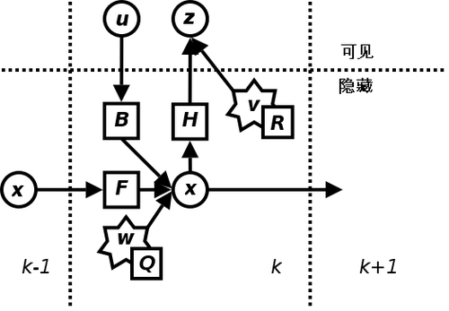

# armor_solver

## 装甲板 MPC 与 V2

现有选板和弹道求解之后接入两轴有限时域约束 MPC。每轴采用
`p[k+1]=p[k]+v[k]·dt+0.5·a[k]·dt²`、`v[k+1]=v[k]+a[k]·dt`，
优化整个时域的加速度序列，代价包含角度跟踪、速度跟踪及加速度幅值。
使用从本地济瞄 `sp_vision_25` 引入的 TinyMPC（ADMM）求解器处理全时域速度与加速度约束。
源码位于 `third_party/tinympc`，通过包内静态库链接，不依赖系统安装的 TinyMPC。
活动集求解实现已移除；求解未收敛或未投影轨迹越界时参考无效。

每次从新鲜 V2 姿态与实际角速度重新初始化，固定当前选中的装甲板预测未来各点，
逐点计算弹道和手动补偿后的角度。Pitch 在规划边界统一为向下为正；Yaw 展开以跨越
±180°。不对相邻图像的选板跳变差分，切换目标或重捕获时不沿用上一目标的控制序列。
间接击打保留选板器的等待时间，并随预测时刻消耗等待时间。

`GimbalCmd.yaw/pitch` 为 MPC 输出角度，四个 `*_deg_s`/`*_deg_s2` 字段是同一首区间
采样时刻的速度和加速度；`exp_yaw/exp_pitch` 仍是原始弹道瞄准角，
`yaw_vel/pitch_vel` 仍保留旧几何速度调试语义，不能替代 MPC 字段。
`target_v_yaw` 始终来自目标消息的敌方自转速度，单位 rad/s。

MPC 用反馈采样年龄加 `predict2send_delay` 将反馈姿态按实际速度外推至参考起点。
目标预测包含图像年龄、`predict2send_delay` 和子弹飞行时间；`additional_prediction_time`
只用于前移目标参考，不在 MPC 输出端再次叠加速度。
输出 `header.stamp` 为求解开始时刻加 `predict2send_delay + sample_time`。
V2 没有视觉参考时间戳，实际部署须标定延迟并与电控约定执行时刻；不能重复补偿。

只有目标与反馈新鲜、坐标系一致、模式为装甲板、弹道和两轴优化成功时，才设置
`reference_valid=true`。速度反馈超过配置上限时拒绝规划，不截断测速伪装可行。
若开启弹道补偿但弹速缺失或弹道失败，参考无效；关闭弹道补偿时允许几何角跟踪，
开火建议仍需要有效弹速。原有火控外再检查规划输出与瞄准点的偏差，尚未跟上时不建议开火。
能量机关不在本次 MPC 覆盖范围。

### 默认参数与状态

参数位于 `solver.mpc`，修改后重启节点。`enabled=false` 会发送无效参考，不回退到 V1。

| 参数 | 默认值 | 含义 |
| --- | --- | --- |
| horizon / dt | 20 / 0.01 s | 0.2 s 预测时域 |
| sample_time | 0.004 s | 首控制区间的输出时刻，对应250 Hz求解周期 |
| position_weight / velocity_weight / acceleration_weight | 1 / 0.002 / 0.00001 | 跟踪与控制代价 |
| max_iterations / tolerance | 3000 / 0.00001 | TinyMPC ADMM 迭代上限、缩放变量的残差容差 |
| yaw.max_velocity / max_acceleration | 720 °/s / 6000 °/s² | Yaw 初始约束 |
| pitch.max_velocity / max_acceleration | 360 °/s / 3000 °/s² | Pitch 初始约束 |
| feedback_timeout / target_timeout | 0.1 s / 0.3 s | 按采样时间判断新鲜度 |

以上约束是联调初始值，未证明符合实车能力；机械限位和电控保护仍由电控实现。
TinyMPC 内部按权重平方根缩放变量，速度和控制额外放大10倍，代价同步换算以保持物理权重。
ADMM rho 固定为 1；每次规划重置迭代状态，避免目标切换继承旧控制。
在参考末端切线的匀速坐标中规划，使匀速参考不会因终端代价产生虚假制动。
采用 TinyMPC 的终端代价，因此数值结果不保证与原活动集有限时域代价一致。
来源代码的 ADMM rho 重复叠加已修正，Riccati 预计算精度也已收紧，详见来源记录。
随机极端参考测试单独使用30000次迭代；默认实时预算3000次不保证覆盖所有极端场景。
达到迭代上限会输出无效参考；实车必须测量两轴规划和弹道生成的总耗时，不能据独立测试认定达到250 Hz。
保留奇点的实际反馈初始化、含半加速度项的双积分模型及首区间输出，
并非复现济瞄整套参考初始化及中点输出。
这是一版双积分参考规划器，不是已经辨识并验证过的电机动力学模型。
完整弹道时域生成在节点求解线程中执行，250 Hz 的实际耗时需要在目标机测量。

检查 `armor_solver/cmd_gimbal.reference_status`：

| 状态 | 含义 |
| --- | --- |
| valid | 完整规划成功，可以由串口编码为有效参考 |
| no_target / no_feedback | 无目标或尚未收到 V2 反馈 |
| stale_target / stale_feedback | 图像目标或反馈采样过期 |
| not_armor_mode / frame_mismatch | 当前任务或反馈坐标系不匹配 |
| ballistic_failed | 开启弹道补偿，但未来轨迹存在求解失败 |
| yaw_mpc_failed / pitch_mpc_failed | 对应轴输入、约束或优化未通过 |
| invalid_mpc_config / invalid_target / invalid_prediction / invalid_reference | 参数或预测非法 |
| wire_float_overflow / pitch_out_of_wire_range | 超出串口表示范围 |
| mpc_disabled / solver_exception | 配置关闭或求解异常 |

核心回归测试覆盖静止、阶跃、匀速、闭环收敛、速度边界、Yaw 跨界、随机可行场景和失败分支。
ROS 集成测试覆盖弹道 Pitch、完整参考、目标切换、采样过期、模式及坐标系。


### TinyMPC 替换验证（2026-10-30）

独立使用 `g++ -std=c++17 -O3 -Wall -Werror` 编译适配器及 TinyMPC 三个运行源文件，
链接 gtest，10项测试全部通过：静止、阶跃、一致p/v/a、匀速、闭环收敛、速度边界、
Yaw跨界、200组随机参考、切换参考状态隔离、预算耗尽/非法输入。
随机压力测试使用30000次迭代，其余使用默认3000次（单迭代失败测试除外）。
专门保留一个默认预算失败、提高预算后成功的场景，避免把有限预算等同于保证收敛。

当前开发环境无 Docker、ROS Humble，尚未执行完整ROS集成编译与集成测试。
在已配置ROS的仓库容器 `/ros_ws` 中执行：

```bash
source /opt/ros/humble/setup.bash
colcon build --symlink-install --packages-up-to armor_solver --parallel-workers 4
source install/setup.bash
colcon test --packages-select armor_solver
colcon test-result --verbose
```

开发机独立单轴耗时检查（每场景200次，初始角度/速度为0；单位ms）：

| 固定参考角 | 中位耗时 | P95 | 最大值 |
| --- | --- | --- | --- |
| 0° | 0.002 | 0.002 | 0.017 |
| 2° | 0.920 | 1.396 | 2.553 |
| 20° | 1.137 | 1.834 | 5.307 |
| 90° | 0.495 | 0.798 | 1.824 |

这不是实车性能承诺，也不包含另一轴、未来弹道生成、ROS调度或串口延迟。
联调先记录 `reference_status`、实际解算频率和总耗时，再调整迭代预算与容差。
静止参考抖动和实际云台振荡尚未通过硬件验证；原 `predict2send_delay: 0.11` 仍需标定。


## qd::ArmorSolverNode

装甲板识别节点

### 发布话题 

* `armor_solver/target` (`rm_interfaces/msg/Target`) - 整车估计的状态
* `armor_solver/measurement` (`rm_interfaces/msg/Measurement`) - EKF的输入观测量
* `armor_solver/cmd_gimbal` (`rm_interfaces/msg/GimbalCmd`) - 云台控制指令

### 订阅话题

*  `armor_detector/armors` (`rm_interfaces/msg/Armors`) - 识别到的装甲板信息

  
### 参数 

* `debug` (`bool`, default: false) - 是否开启调试模式
* `target_frame` (`string`, default: "odom") - 目标坐标系
* `ekf.sigma2_q_xyz` (`double`, default: 0.05) - 状态转移噪声方差 (x,y,z)
* `ekf.sigma2_q_yaw` (`double`, default: 1.0) - 状态转移噪声方差 (yaw)
* `ekf.sigma2_q_r` (`double`, default: 80.0) - 状态转移噪声方差 (r)
* `r_xyz_factor` (`double`, default: 1.0) - 位置观测噪声方差系数 (x,y,z)
* `r_yaw_factor` (`double`, default: 1.0) - 位置观测噪声方差系数 (yaw)
* `tracker.max_match_distance` (`double`, default: 0.5) - 两帧间目标可匹配的最大距离
* `tracker.max_match_yaw_diff` (`double`, default: 0.5) - 两帧间目标同一块装甲板可匹配的最大yaw角差（大于这个值则认为装甲板发生跳变）
* `tracker.tracking_thres` (`int`, default: 2) - `DETECTING` 状态进入 `TRACKING` 状态需要连续识别到的帧数
* `tracker.lost_thres` (`double`, default: 1.0) - `TRACKING` 状态进入 `LOST` 状态需要连续丢失的时间（s）
* `solver.prediction_delay` (`double`, default: 0.0) - 预测延迟时间（s），会影响选版
* `solver.controller_delay` (`double`, default: 0.0) - 控制延迟时间（s），不会影响选版
* `solver.max_tracking_v_yaw` (`double`, default: 60.0) - 转速大于这个值时，瞄准中心
* `solver.side_angle` (`double`, default: 15.0) - 跳转到下一装甲板的角度阈值,越大越容易切板
* `solver.gravity` (`double`, default: 9.8) - 重力加速度
* `solver.compensator_type` (`string`, default: "ideal") - 补偿器类型，可选 `ideal` / `resistance` / `ceres`
* `solver.resistance` (`double`, default: 0.001) - 空气阻力

弹速直接采用 `/serial/receive.bullet_speed`，视觉不再设置弹速参数或二次滤波。收到首个有效弹速前不会进行弹道补偿或建议开火。


## ArmorSolverNode
装甲板处理节点

订阅识别节点发布的装甲板三维位置及机器人的坐标转换信息，将装甲板三维位置变换到指定惯性系（一般是以云台中心为原点，IMU 上电时的 Yaw 朝向为 X 轴的惯性系）下，然后将装甲板目标送入跟踪器中，输出跟踪机器人在指定惯性系下的状态

订阅：
- 已识别到的装甲板 `/detector/armors`
- 机器人的坐标转换信息 `/tf` `/tf_static`

发布：
- 最终锁定的目标 `/tracker/target`

参数：
- 跟踪器参数 tracker
  - 两帧间目标可匹配的最大距离 max_match_distance
  - `DETECTING` 状态进入 `TRACKING` 状态的阈值 tracking_threshold
  - `TRACKING` 状态进入 `LOST` 状态的阈值 lost_threshold

## ExtendedKalmanFilter

$$ x_c = x_a + r * cos (\theta) $$
$$ y_c = y_a + r * sin (\theta) $$

$$ x = [x_c, y_c,z, yaw, v_{xc}, v_{yc},v_z, v_{yaw}, r]^T $$

参考 OpenCV 中的卡尔曼滤波器使用 Eigen 进行了实现

[卡尔曼滤波器](https://zh.wikipedia.org/wiki/%E5%8D%A1%E5%B0%94%E6%9B%BC%E6%BB%A4%E6%B3%A2)



考虑到自瞄任务中对于目标只有观测没有控制，所以输入－控制模型 $B$ 和控制器向量 $u$ 可忽略。

预测及更新的公式如下：

预测：

$$ x_{k|k-1} = F * x_{k-1|k-1} $$

$$ P_{k|k-1} = F * P_{k-1|k-1}* F^T + Q $$

更新:

$$ K = P_{k|k-1} * H^T * (H * P_{k|k-1} * H^T + R)^{-1} $$

$$ x_{k|k} = x_{k|k-1} + K * (z_k - H * x_{k|k-1}) $$

$$ P_{k|k} = (I - K * H) * P_{k|k-1} $$

## Tracker

参考 [SORT(Simple online and realtime tracking)](https://ieeexplore.ieee.org/abstract/document/7533003/) 中对于目标匹配的方法，使用卡尔曼滤波器对单目标在三维空间中进行跟踪

在此跟踪器中，卡尔曼滤波器观测量为目标在指定惯性系中的位置（xyz），状态量为目标位置及速度（xyz+vx vy vz）

在对目标的运动模型建模为在指定惯性系中的匀速线性运动，即状态转移为 $x_{pre} = x_{post} + v_{post} * dt$

目标关联的判断依据为三维位置的 L2 欧式距离

跟踪器共有四个状态：
- `DETECTING` ：短暂识别到目标，需要更多帧识别信息才能进入跟踪状态
- `TRACKING` ：跟踪器正常跟踪目标中
- `TEMP_LOST` ：跟踪器短暂丢失目标，通过卡尔曼滤波器预测目标
- `LOST` ：跟踪器完全丢失目标

工作流程：

- init：

  跟踪器默认选择离相机光心最近的目标作为跟踪对象，选择目标后初始化卡尔曼滤波器，初始状态设为当前目标位置，速度设为 0

- update:

  首先由卡尔曼滤波器得到目标在当前帧的预测位置，然后遍历当前帧中的目标位置与预测位置进行匹配，若当前帧不存在目标或所有目标位置与预测位置的偏差都过大则认为目标丢失，重置卡尔曼滤波器。
  
  最后选取位置相差最小的目标作为最佳匹配项，更新卡尔曼滤波器，将更新后的状态作为跟踪器的结果输出
